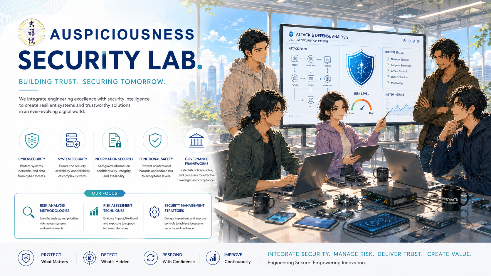

# Security Concepts   概念說明   

  

> [!TIP]  
> Please refer to the [Reference](#reference--參考資訊) section below for the technical acronyms used in this document.  
> 本文所使用之技術縮寫，請參閱下方 [參考資訊](#reference--參考資訊)。  

## The CIA Triad｜CIA 三元素  

**Confidentiality｜機密性**  
誰能看。  

* Information is not made available or **disclosed** to unauthorized subjects (individuals, entities, or processes).  
  資訊不會提供或**揭露**給未經授權的主體（個人、實體或流程）。  
* Preserving authorized restrictions on information access and disclosure (preventing data breaches), including means for protecting personal privacy and proprietary information.  
  維持資訊存取與揭露的授權限制（防止資料外洩），包含保護個人隱私與專有資訊的措施。  

Confidentiality: Protect Data｜機密性：保護資料  

* Data encryption. (Domain 3: Technical aspects)  
  資料加密。（領域 3：技術層面）  
* Access control. (Domain 5: Technical aspects)  
  存取控制。（領域 5：技術層面）  
* Nondisclosure agreements. (e.g., NDA. Legal aspects)  
  保密協議。（例如：NDA，法律層面）  

A part of defense-in-depth.  
屬於縱深防禦（Defense-in-Depth）的一環。  

**Integrity｜完整性**  
誰能改。  
Keywords: Tamper, trust.｜關鍵字：竄改、信任。  

* Accuracy and completeness.  
  正確性與完備性。  
* Data has not been **altered** in an unauthorized manner.  
  資料未以未經授權的方式遭到**變更**。  

Integrity: Verify Data｜完整性：驗證資料  

* Data validation. (correct)  
  資料驗證。（確保正確）  
* Audit trails and logging.  
  稽核軌跡與日誌記錄。  
* Digital signatures. (Protection for the two points above.)  
  數位簽章。（用於保護上述兩項機制。）  

**Availability｜可用性**  
誰能用。  
Scope = Data, system, service.｜範圍 = 資料、系統、服務。  
Keywords: Disruption, DoS.｜關鍵字：中斷、阻斷服務（DoS）。  

* Being **accessible** and usable on demand by an authorized entity.  
  授權實體可隨時依需求**存取**及使用。  
* Timely, reliable access to data and information services for authorized users.  
  為授權使用者提供及時且可靠的資料與資訊服務存取。  

Availability: Make Data Accessible｜可用性：確保資料可存取  

* Redundant systems and backups.  
  備援系統與備份。  
* Disaster recovery and business continuity plans. (BCP, DRP)  
  災害復原計畫與營運持續計畫。（BCP、DRP）  
* Access management.  
  存取管理。

## AAA｜AAA 架構

**Authenticity｜真實性**  
Keywords: Proof-of-origin.｜關鍵字：來源證明。  
Authenticity - 目的；Authentication - 手段（身分驗證）。  

* Verification of Data Sources｜驗證資料來源  
    * Does the data have a trustworthy source (MAC, digital signature)?  
      資料是否具備可信任的來源（訊息鑑別碼 MAC、數位簽章）？  

* Authenticity of Access and Communications｜存取與通訊的真實性  
    * Verify communications for authenticity. (Network protocols, e.g., TLS)  
      驗證通訊的真實性。（網路協定，例如：TLS）  
    * Use secure channels for all communication. (Network protocols, e.g., TLS)  
      所有通訊皆使用安全通道。（網路協定，例如：TLS）  
    * Use digital certificates in data exchanges.  
      在資料交換中使用數位憑證。  

* Authentication of Users and Systems｜使用者與系統的身分驗證  
    * Authenticate users and systems.  
      驗證使用者與系統的身分。  
        * Users: MFA, biometrics, passwordless (FIDO / Web Authentication).  
          使用者：多因素驗證（MFA）、生物辨識、無密碼驗證（FIDO / Web 驗證）。  
        * Systems: MAC, API key, mTLS.  
          系統：訊息鑑別碼（MAC）、API 金鑰、雙向傳輸層安全性協定（mTLS）。  
    * Review and update authentication protocols (process, technology).  
      定期檢視並更新身分驗證協定（流程與技術）。  

## Non-repudiation｜不可否認性  

Prevent the after-the-fact denial of:  
防止事後否認以下行為：  

* Actions: Audit trails and logs. (Accountability)  
  動作行為：稽核軌跡與日誌記錄。（可究責性）  
* Messages transferred: Digital signatures.  
  傳輸的訊息：數位簽章。  

Audit Trails and Logs｜稽核軌跡與日誌記錄  

* Ensure actions related to the integrity process are logged and securely stored, including:  
  確保與完整性流程相關的動作皆有記錄並安全儲存，包含：  
    * Data migrations.  
      資料遷移。  
    * User access changes.  
      使用者存取權限變更。  
    * System configuration updates.  
      系統組態更新。  
    * Digital signatures. (for the 3 critical actions above)  
      數位簽章。（針對上述 3 項關鍵動作）  

Digital Signatures｜數位簽章  

* Implement digital signatures to:  
  導入數位簽章以達成以下目標：  
    * Ensure all communications and transactions cannot be denied.  
      確保所有通訊與交易皆無法被否認。  
    * Ensure both parties digitally sign in the case of a data transfer.  
      確保資料傳輸時雙方皆進行數位簽章。  

Asymmetric encryption (非對稱式加密) + hash (雜湊).  
e.g., e-mail, S/MIME -> Authenticity, Integrity, Non-repudiation of sender.  
例如：電子郵件、S/MIME -> 確保寄件人的真實性、完整性與不可否認性。 

---

# Reference | 參考資訊  

| Abbreviation 縮寫 | Full Name 英文全文 | Explanation and References 說明與參考資訊 |
| --- | --- | --- |
| **NDA** | Nondisclosure Agreement | **保密協議**。屬於法律層面（Legal aspects），用於保護專有資訊（Proprietary Information）不外洩。 |
| **DoS** | Denial of Service | **阻斷服務攻擊**。屬於 Availability（可用性）的常見威脅，意指攻擊者透過癱瘓系統使合法使用者無法存取服務。 |
| **BCP** | Business Continuity Plan | **業務連續性計畫**。屬於可用性保障措施，確保企業在面臨災難或中斷時能持續運作。 |
| **DRP** | Disaster Recovery Plan | **災害復原計畫**。與 BCP 相輔相成，專門針對重大資安事件或天災後的系統與資料搶救。 |
| **MAC** | Message Authentication Code / Media Access Control (依上下文而定) | 在這裡的認證/完整性語境中通常指 **訊息鑑別碼**，用於驗證資料來源的真實性與完整性；在網路層面則可指實體硬體位址。 |
| **TLS** | Transport Layer Security | **傳輸層安全性協定**。用於保護網路通訊的安全通道，確保資料傳輸過程中的機密性與完整性。 |
| **MFA** | Multi-Factor Authentication | **多因素驗證**。使用者身分認證的一種方式，結合密碼、OTP、生物辨識等兩種以上的驗證要素。 |
| **FIDO** | Fast Identity Online | 一套旨在減少密碼依賴的**線上快速身分驗證**開放標準。 |
| **API** | Application Programming Interface | **應用程式介面**。系統間進行互動的介面，常透過 API Key 來進行系統層的身分驗證（Authentication of Systems）。 |
| **mTLS** | Mutual Transport Layer Security | **雙向傳輸層安全性協定**。通訊雙方互相驗證彼此的數位憑證（Client & Server 雙向驗證），常用於微服務或高安全性系統介接。 |
| **S/MIME** | Secure/Multipurpose Internet Mail Extensions | **安全多用途網際網路郵件擴充協定**。利用公開金鑰加密（Asymmetric Encryption）與數位簽章技術，來同時達成電子郵件的**真實性（Authenticity）**、**完整性（Integrity）**以及**寄件人不可否認性（Non-repudiation）**。 |

---

# License｜授權條款

     
Security Concepts © 2026 by Jen Yuan Pan is licensed under the `Creative Commons Attribution-NonCommercial-ShareAlike 4.0 International`.  
概念說明 © 2026 作者 潘貞元（Reta Pan），採用 `Creative Commons 姓名標示－非商業性－相同方式分享 4.0 國際版` 授權。  

For the complete license terms, rights and obligations, restrictions on use, and other applicable conditions, please refer to the [Full License Terms](https://github.com/retamotome/SecurityGovernance/blob/main/LICENSE.md). By using this work, you acknowledge that you have read, understood, and agree to comply with such terms.  
詳細授權內容、權利義務、使用限制及其他相關條件，請參閱《[完整授權條款](https://github.com/retamotome/SecurityGovernance/blob/main/LICENSE.md)》。您使用本作品，即表示已充分閱讀、確已知悉並同意遵守該等條款與規定，並承認其具有法律約束力。     

---

> [!note]  
> **AI Translation Notice | AI 翻譯說明**  
> The Chinese content of this document has been generated through AI-based translation and is presented using Traditional Chinese characters and terminology commonly used in Taiwan to ensure clarity, localization, and readability.  
> 本文之中文內容係由人工智慧（AI）翻譯產出，並採用正體中文及台灣常用語彙進行表述，以確保內容符合在地語言之使用與閱讀習慣。  

