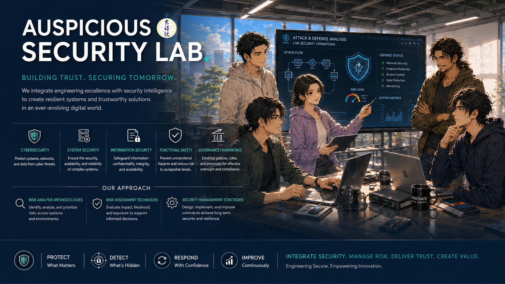

# AUSPICIOUS SECURITY LAB   

  

## Overview | 概要  

This lab provides comprehensive coverage of cybersecurity, system security, information security, functional safety, and their governance frameworks. It introduces risk analysis methodologies, risk assessment techniques, and security management strategies to help participants understand and address security and safety challenges in modern systems and organizations.  

All course materials are developed based on the CISSP (Certified Information Systems Security Professional) Common Body of Knowledge (CBK), providing a structured and industry-recognized foundation for security governance, risk management, and security engineering.  

本實驗室涵蓋網路安全（Cybersecurity）、系統安全（System Security）、資訊安全（Information Security）、功能安全（Functional Safety）及其治理架構（Governance Frameworks）等領域，並介紹風險分析方法、風險評估技術與安全管理策略，協助學員理解並有效因應現代系統與組織所面臨的安全與風險挑戰。  

所有教材內容皆以 CISSP（Certified Information Systems Security Professional，國際資訊系統安全認證）之共同知識體系（CBK, Common Body of Knowledge）為基礎建構，提供具系統性且符合業界最佳實務的安全治理、風險管理與安全工程知識框架。  

## Domains｜主題

[Security and Risk Management](./Domain01/README.md)  

## References｜參考資訊  

* [ISC2 CISSP Official Textbook](https://isc2.vitalsource.com)  
* [ISC2 CISSP Study Tools and Resources](https://www.isc2.org/certifications/cissp/cissp-self-study-resources)  
* [ISC2 CISSP Official Study Guide 10ed, 2024](https://www.wiley.com/en-fr/shop/general-introductory-computer-science/isc2-cissp-certified-information-systems-security-professional-official-study-guide-10th-edition-p-9781394254705)  
* [CISSP Official Practice Tests 4ed, 2024](https://www.wiley.com/en-us/shop/general-introductory-computer-science/isc2-cissp-certified-information-systems-security-professional-official-practice-tests-4th-edition-p-9781394255085)  
* [CISSP-Study-Resources](https://github.com/jefferywmoore/CISSP-Study-Resources)  
* [Wiley Test Bank](https://study.learning.wiley.com/)  

---

# License｜授權條款

     
This work © 2026 by Jen Yuan Pan is licensed under the `Creative Commons Attribution-NonCommercial-ShareAlike 4.0 International`.  
本作品 © 2026 作者 潘貞元（Reta Pan），採用 `Creative Commons 姓名標示－非商業性－相同方式分享 4.0 國際版` 授權。  

For the complete license terms, rights and obligations, restrictions on use, and other applicable conditions, please refer to the [Full License Terms](https://github.com/retamotome/SecurityGovernance/blob/main/LICENSE.md). By using this work, you acknowledge that you have read, understood, and agree to comply with such terms.  
詳細授權內容、權利義務、使用限制及其他相關條件，請參閱《[完整授權條款](https://github.com/retamotome/SecurityGovernance/blob/main/LICENSE.md)》。您使用本作品，即表示已充分閱讀、確已知悉並同意遵守該等條款與規定，並承認其具有法律約束力。     

---

> [!note]  
> **AI Translation Notice | AI 翻譯說明**  
> The Chinese content of this document has been generated through AI-based translation and is presented using Traditional Chinese characters and terminology commonly used in Taiwan to ensure clarity, localization, and readability.  
> 本文之中文內容係由人工智慧（AI）翻譯產出，並採用正體中文及台灣常用語彙進行表述，以確保內容符合在地語言之使用與閱讀習慣。  

